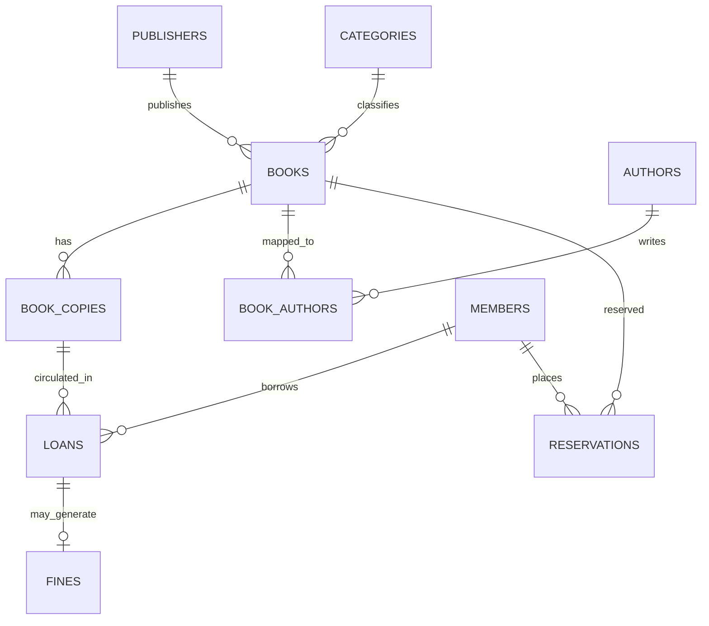

# ER Diagram (Mermaid)

## Cardinalities
- One publisher can publish many books; each book has zero or one publisher.
- One category can classify many books.
- A book can have multiple physical copies.
- Books and authors have a many-to-many relationship through `book_authors`.
- One member can have many loans and reservations.
- One copy can appear in multiple historical loans, but only one active issue should exist at a time (enforced by application transaction logic).
- One loan may generate at most one fine.
